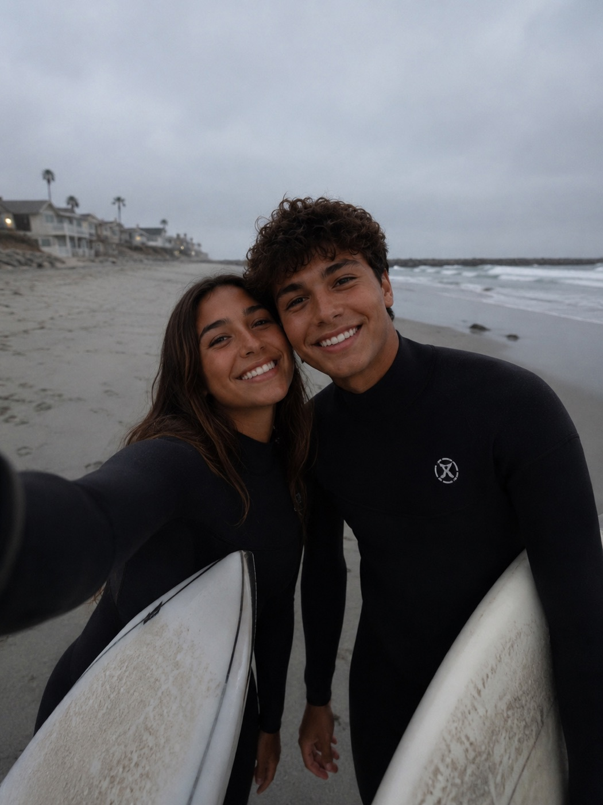
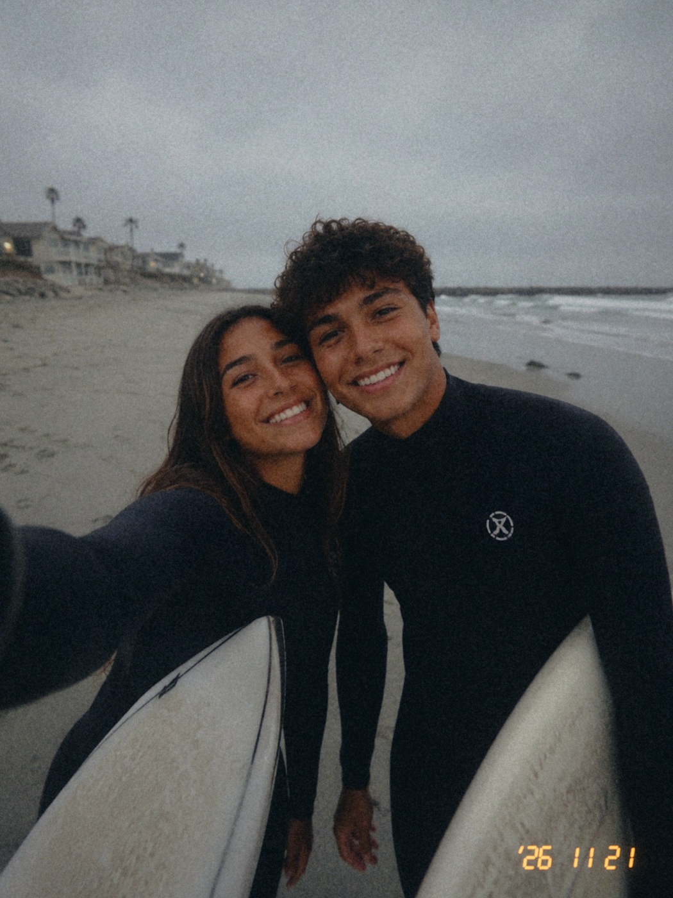

<p align="center">
  
</p>

<h1 align="center">Marenn 400</h1>

<p align="center">
  The film look from <a href="https://relayyyy.com">Relay</a>, open source.<br>
  A single-use camera in five Metal compute kernels. No LUTs, no dependencies.
</p>

<p align="center">
  <a href="https://developer.relayyyy.com">developer.relayyyy.com</a> · Swift + Metal · GPL-3.0
</p>

---

## What this is

Every photo shot in the Relay app develops through exactly one filter. There are no presets and no strength slider. This repo is that filter.

Marenn 400 started from measurement: real film scans aligned against digital captures of the same scenes, each stage of a pipeline fitted until the colour difference dropped to a few dE. That measured tone curve and colour grade are still the heart of it, unchanged. Version 2 rebuilds everything around them so the photo travels the way light does through a cheap single-use camera: out of the scene, through a moulded plastic lens, into 400 speed colour negative film, onto a print. Warm, never teal.

| Original | Marenn 400 |
| --- | --- |
|  |  |
|  |  |

## The pipeline

The whole filter lives in one file, `MarennFilter.swift`. The Metal source is embedded as a string and compiled at runtime, so the Swift structs and the shader stay in one place and cannot drift apart. All kernels share one uniform struct, `MarennParams`. Five kernels run in sequence:

1. **`marenn_lens`** is the camera. The photo is decoded back to linear light and pushed through a 32 mm f/10 single element plastic lens: a hint of barrel distortion, lateral colour that grows toward the corners, axial colour (red and blue focus slightly behind green, so edges carry a faint fringe), field curvature with an astigmatic smear that runs radially, a touch of coma that gives corner highlights a comet tail, and the natural cos⁴ falloff of a wide simple lens. Working in light rather than in display values is what makes highlights spread and bloom the way they do on film.
2. **`marenn_extract`** halves the frame and pulls out the halation source. Halation is light that crossed the whole emulsion and bounced back off the film base, so it is driven mostly by red, which reaches the bottom layer, and it exposes that red layer. Clipped areas are given back some of the brightness the sensor could not record, so lamps and the sun glow like the bright things they were.
3. **`marenn_down`** builds a glow pyramid with a 13 tap filter, down to about 16 px on the short side.
4. **`marenn_up`** folds the pyramid back up, weighting each level separately for the veiling glare of an uncoated lens and for halation. Levels are counted from the coarsest, so the glow keeps the same size relative to the frame at any resolution.
5. **`marenn_film`** develops and prints. Highlights melt slightly into their surroundings, the lens glare and the red halation spill are added, the film shoulder rolls highlights off, grain is grown in the negative, the measured Marenn print curve and grade are applied, the measured print bloom warms bright areas, and the result is dithered to 8 bits so skies never band.

The print stage is the original measured look: a seven knot Hermite spline tone curve, cool shadow tint, warm midtone and highlight tints, global saturation, and the blue sky treatment that saturates, darkens and hue shifts skies the way negative film renders them.

Exposure is scene adaptive. Before the GPU work starts, the filter builds a luminance histogram of the photo and derives a gain from the median, clamped to a sane range. A dim indoor shot and a noon beach shot both land on the same roll. Dim frames also get what a real roll would have given them: a little extra grain where the lab printed the shadows up, and a gentle amber cast, because film never white balanced for lamps.

### Grain

Version 1 built grain from two octaves of value noise on a square lattice. Its spectrum was a box with bright horizontal and vertical lines through it, which shows up as faintly linear, blocky texture, and it was identical in all three channels. Version 2 grows grain the way the gaussian limit of a physical grain model says it should look (Newson et al., *Realistic Film Grain Rendering*, 2017):

- **No lattice.** Per-pixel PCG noise, gaussian filtered, plus a trace of sparse jittered clumps. The spectrum is round and neighbouring pixels correlate equally in every direction.
- **Mostly shared, a little per layer.** Each dye layer gets a small independent share, the blue sensitive layer a bit more, as on real colour negative.
- **Shaped by the print.** Grain is added in the negative, before the print curve, so the curve's slope does what a print does: strongest in the midtones, quieter in the highlights.
- **Sized to the frame.** A pixel shows grain integrated over its area. When a dye cloud would be smaller than a pixel it is drawn at pixel size and scaled so the pixel-integrated strength matches, so a 1000 px preview and a 24 MP capture look alike on a phone screen (measured within 8 percent).

One honest warning remains true: the defaults in `MarennParams` look like magic numbers because they are. The print stage values are the measured ones. The lens and film values were tuned by eye against real single-use camera behaviour. Tuning them is the fun part, but the defaults are the Relay look.

## Per-shot quirks

The look has no knobs. The camera has a few quirks, passed per photo through `MarennOptions`:

```swift
var options = MarennOptions()
options.seed = 42                    // fix the grain field and frame character; nil rolls a new frame
options.dateStamp = Date()           // burn in an orange '26 11 21 imprint, like an old date back
options.lightLeak = 0.5              // 0...1, a warm leak from the film door; off by default
options.frameVariation = 1           // 0...1, small exposure and colour drift between frames
let developed = MarennFilter.apply(to: photo, options: options)
```

The date imprint is exposed into the film, not drawn on top: it glows, halates and carries grain, and like the real thing it all but disappears on bright backgrounds.

<p align="center">
  
</p>

## Try it from the command line

`Tools/marenn_cli.swift` is a small macOS tool that compiles together with the filter itself, so it runs exactly the engine the app ships. No Xcode project needed:

```
swiftc -O -parse-as-library MarennFilter.swift Tools/marenn_cli.swift -o marenn
./marenn beach.jpg out.png
```

Options:

```
--seed N            fix the grain field and frame character (default 3)
--random            roll a fresh frame every run
--nograin           develop without grain
--stamp [DATE]      date imprint, YYYY-MM-DD, default today
--leak X            light leak strength, 0...1
--variation X       frame to frame drift, 0...1 (default 1)
--set field=value   override any MarennParams field, e.g. --set grainAmount=0.03
```

## No Mac? The CPU reference renderer

`Tools/cpu` runs the same Metal source on an ordinary CPU. A small header (`metal_stdlib`) gives clang just enough of the Metal Shading Language, `msl2cpp.py` lifts the shader out of `MarennFilter.swift` and reads every default straight from the Swift struct, and `marenn_cpu.cpp` mirrors the host code. It needs clang, Python, numpy and Pillow:

```
python3 Tools/cpu/marenn.py beach.jpg out.png --stamp 2026-11-21
```

It is exact enough to trust: on Apple silicon the GPU and CPU renders of the examples differ by 0.03 to 0.06 levels on average, never more than 1.

## In the browser (WebGL2)

`Tools/web` runs the same filter in a browser. `msl2glsl.py` translates the Metal source in `MarennFilter.swift` into GLSL, so the web version cannot drift from the app, and `marenn-gl.js` mirrors the Swift host code:

```
python3 Tools/web/msl2glsl.py MarennFilter.swift Tools/web/marenn-shaders.js
```

```html
<script src="marenn-shaders.js"></script>
<script src="marenn-gl.js"></script>
<script>
  const out = new MarennGL().develop(imageData, { seed: 42, dateStamp: new Date() });
  // out.data is RGBA bytes, out.width / out.height its size
</script>
```

Checked in headless Chromium against the CPU reference on the rooftop and surf examples and the date imprint and light leak case: mean difference 0.000 levels, never more than 1. It has not yet been run on a real GPU, and there is no CI job for it.

## Use it in an app

`MarennFilter.swift` targets iOS (UIKit in, UIKit out):

```swift
let developed = MarennFilter.apply(to: photo)
```

The engine underneath (`MarennEngine`) works on `CGImage` and has no UIKit in its core path. UIKit is behind `#if canImport(UIKit)`, which is why the same file builds into the macOS command line tool.

## Validation

Every push runs `.github/workflows/validate.yml` on a macOS runner. It compiles the embedded shader with Apple's Metal compiler for iOS and macOS with warnings as errors, type-checks the file against the iOS SDK, builds the command line tool, renders the examples on the GPU, and diffs them against the CPU reference.

## Repo layout

```
MarennFilter.swift      the filter, Swift host code + embedded Metal source
Tools/marenn_cli.swift  macOS command line tool, built together with the filter
Tools/cpu/              CPU reference renderer for machines without Metal
Tools/web/              WebGL2 port, generated from the Metal source
Examples/               before and after samples used in this README
LICENSE                 GPL-3.0
```

## License

GPL-3.0. Use it, learn from it, build on it, and keep what you make open too. See `LICENSE` for the full text.

The Relay name, the Relay logo, and the app itself are not covered by this license. They belong to Tobias Schmidt Services LLC.
