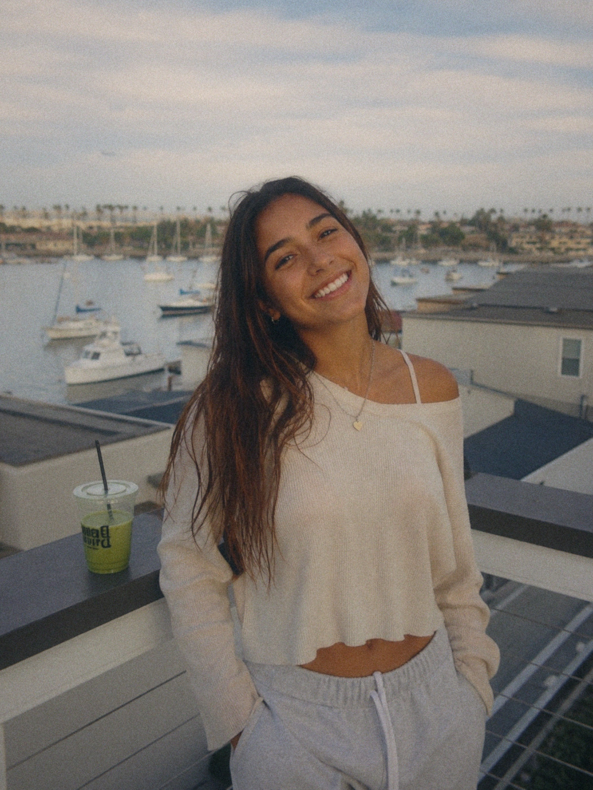
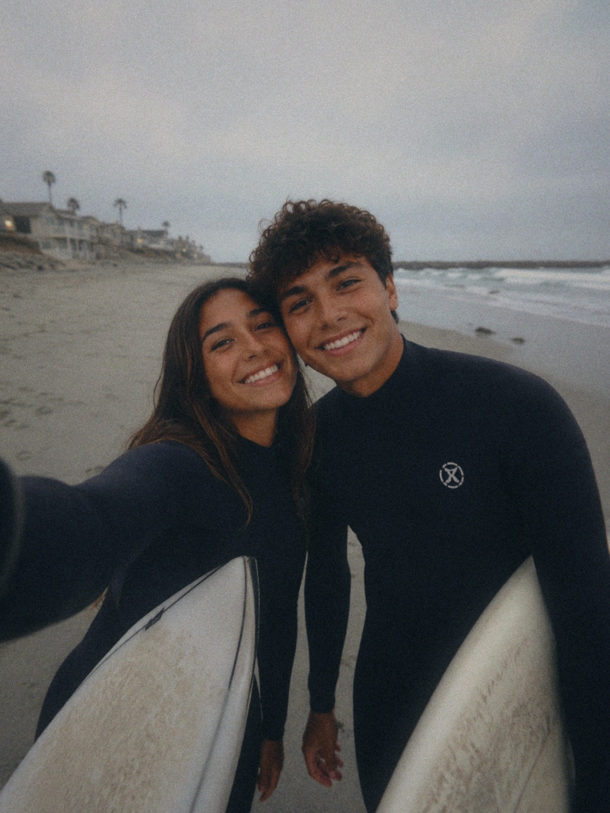
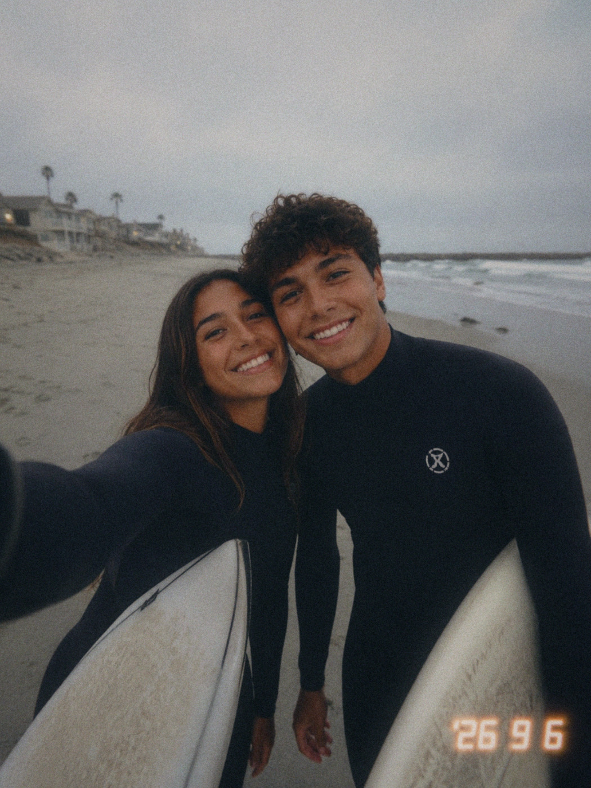

<p align="center">
  
</p>

<h1 align="center">Vesper 800</h1>

<p align="center">
  The film look from <a href="https://relayyyy.com">Relay</a>, open source.<br>
  Seven Metal compute kernels, measured against real film, tuned for the way phones shoot at night. No LUTs, no dependencies.
</p>

<p align="center">
  <a href="https://developer.relayyyy.com">developer.relayyyy.com</a> · Swift + Metal · GPL-3.0
</p>

---

## What this is

Every photo shot in the Relay app develops through exactly one filter. There are no presets and no strength slider. This repo is that filter.

Vesper 800 is the successor to Marenn 400. It keeps what Marenn got right, a print curve fitted against real film scans until the color difference dropped to a few dE, and rebuilds everything around it: exposure and every optical effect now happen in linear light, the color work happens in OKLab, halation sits where it sits on real film, and the grain is a grain model rather than noise. The name is the evening light this look was tuned for. The 800 is the speed: faster, grainier, happier at a party than on a beach at noon, though it does both.

Warm, never teal. That rule survived the overhaul.

| Original | Vesper 800 |
| --- | --- |
|  |  |
|  |  |

With the optional databack stamp:

<p align="center"></p>

The example renders come from the CPU harness in `Tools/ref`, which runs the same Metal source line for line. On the shipped Marenn 400 examples that harness matches the GPU output within 1.5/255 RMS.

## The pipeline

The whole filter lives in one file, `MarennFilter.swift` (the name stays so projects that reference it by path keep building). The Metal source is embedded as strings and compiled at runtime, so the Swift structs and the shader stay in one place and cannot drift apart. Seven kernels run in eleven dispatches:

1. **`vesper_expose`** decodes sRGB to linear light and applies the exposure gain and a bounded white balance nudge. If asked, it also exposes the databack stamp and a light leak onto the frame as light, which means they go through everything that follows: the curve, the halation, the grain.
2. **`vesper_halo_source`** works at half resolution. It takes the light that gets through the emulsion (a soft knee above a threshold), keeps the source color, and weights it red dominant, because halation is light bouncing off the film base into the red sensitive layer. The alpha channel carries the unthresholded luma for veiling glare.
3. **`vesper_down`** and **`vesper_blur`** build the halo. A tight core at half resolution and a faint wide aura at eighth resolution, with red spreading widest and blue least. The blur uses as many taps as the radius needs, so a 12 MP capture gets the same halo as a thumbnail.
4. **`vesper_develop`** is the film. Halation and glare are added to the linear scene, a soft shoulder compresses what would clip while desaturating it toward white, then the measured seven knot curve shapes the tones, a toe lift gives the faded floor, and the three zone tints do the split tone: cool blue shadows, red warm mids and highlights. The color stage runs in OKLab: saturated colors get denser and darker the way dye does, low chroma colors get a little more life than high chroma ones, skin is pulled gently toward the skin line and calmed, foliage goes yellow-olive, skies deepen, teal is trimmed, and highlights lose chroma toward white. A gamut safe step keeps hue and luminance when a channel would clip.
5. **`vesper_diffuse`** softens highlights in linear light, a ring blur plus a touch of bloom, so highlights roll off instead of clipping.
6. **`vesper_print`** models the lens and the print. Anisotropic edge defocus and chromatic aberration that grow toward the corners, a natural cos^4 style vignette in linear light, the sRGB encode, and then the grain: two octaves of lattice noise from an integer hash (bit exact on every device), a per pixel hash for crispness, an amplitude that peaks in the midtones with a floor in the shadows, a small decorrelated chroma component with blue slightly coarser, and a half code value dither so a render without grain cannot band.

## Scene adaptive development

Before the GPU work starts, the filter samples about forty thousand pixels into a 256 bin luma histogram. From it:

- **Exposure.** A gain in linear light aimed at a target median, clamped, and capped so the 90th percentile never gets pushed past white. A dim indoor shot and a noon beach shot land on the same roll.
- **White balance.** A gray world estimate on the mid tones nudges each channel by at most three percent, and fades out for scenes that are colored on purpose.
- **Flash, night, high key.** Continuous weights, never a mode switch. A flash-like histogram gets a deeper toe, more halation and a stronger vignette. A dark scene gets more grain. A bright scene raises the halation threshold.
- **Seed.** The grain and roll seed is derived from the histogram and the dimensions, so a preview and an export of the same photo look identical. Pass your own to override.
- **Roll variance.** From the seed, a tiny exposure and warmth jitter per shot, so a roll of photos feels like a roll of film rather than one filter applied twenty times.

## Options

```swift
var options = VesperOptions()
options.dateStamp = VesperOptions.dateStamp(for: photo.captureDate)   // "'26 9 6"
options.lightLeak = 0.35                                              // 0 by default
options.seed = 42                                                     // nil derives one from the photo
options.flash = true                                                  // nil infers it
options.stock = .marenn400                                            // the old look, exact
let developed = VesperFilter.apply(to: photo, options: options)
```

Everything is off or automatic by default. `VesperEngine.shared?.lastReport` tells you what the engine measured and decided for the last photo.

## Try it from the command line

`Tools/vesper_cli.swift` is a small macOS harness that compiles against the engine file, so there is exactly one copy of the host code and the shader. No Xcode project needed:

```
swiftc -O Tools/vesper_cli.swift MarennFilter.swift -o vesper
./vesper beach.jpg out.png
```

Options:

```
--stock vesper800|marenn400   pick the look (Vesper 800 by default)
--seed N                      fix the grain and roll seed
--nograin                     disable grain
--date "'98 8 24"|auto|none   databack stamp; auto reads the EXIF capture date
--leak 0.35                   warm light leak strength, 0 to 1
--flash 0|1                   override flash detection
--stats                       print what the engine measured and decided
```

EXIF orientation is applied on load, so phone photos come out upright.

## Try it without a Mac

`Tools/ref` compiles the real Metal source on the CPU through a small `metal_stdlib` shim and mirrors the engine dispatch by dispatch. It needs g++ (OpenMP is used when available), python3, numpy and Pillow, plus scipy for `--compare`:

```
pip install numpy Pillow scipy
python3 Tools/ref/vesper_ref.py beach.jpg out.png --stats
python3 Tools/ref/vesper_ref.py Examples/original-surf.jpg check.png --stock marenn400 --compare Examples/filtered-surf.jpg
```

It is how this look was tuned, and it doubles as the test suite: `check_layout.py` asserts that every parameter struct matches its Metal twin field for field and that every kernel the host asks for exists, `swift_parse.py` is a tree-sitter syntax check for machines without a Swift toolchain, and `lab.py` makes contact sheets, synthetic charts and OKLab statistics.

## Use it in an app

`MarennFilter.swift` as shipped targets iOS (UIKit in, UIKit out) and also builds on macOS without UIKit:

```swift
let developed = VesperFilter.apply(to: photo)
```

`MarennFilter.apply(to:)` still exists and forwards to Vesper, so code written against Marenn 400 keeps compiling and gets the current look. The engine underneath (`VesperEngine`) works on `CGImage`; the CLI harness is proof of that.

## Marenn 400 is still here

Three ways back, from lightest to heaviest:

1. `options.stock = .marenn400` runs the untouched Marenn 400 kernels with the untouched parameters. Exact old output, no rebuild of the look.
2. If a device rejects the Vesper 800 shader, the engine prints the compiler error and compiles the Marenn 400 kernels instead. The app never loses its filter.
3. The `main` branch. This overhaul lives on its own branch until it is merged.

One honest warning stays true: the parameter defaults in the `*P` structs look like magic numbers because they are. They are the tuned, shipped values. Tuning them is the fun part, and `Tools/ref` is how to see what you did.

## Repo layout

```
MarennFilter.swift        the filter: Swift host + embedded Metal source, both stocks
Tools/vesper_cli.swift    macOS command line harness
Tools/ref/                CPU reference renderer, parity checks, tuning lab
Examples/                 before and after samples used in this README
CHANGELOG.md              what changed, and when
LICENSE                   GPL-3.0
```

## License

GPL-3.0. Use it, learn from it, build on it, and keep what you make open too. See `LICENSE` for the full text.

The Relay name, the Relay logo, and the app itself are not covered by this license. They belong to Tobias Schmidt Services LLC.
