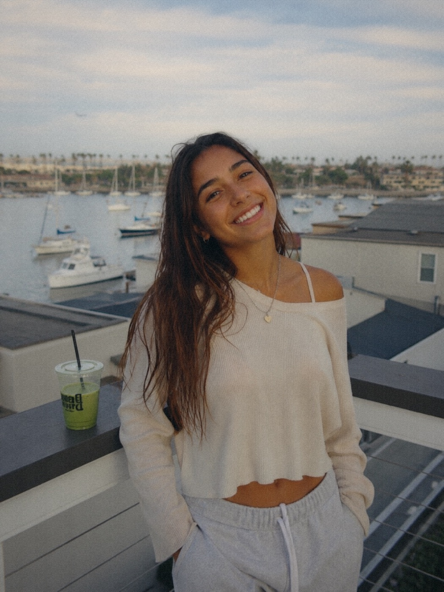
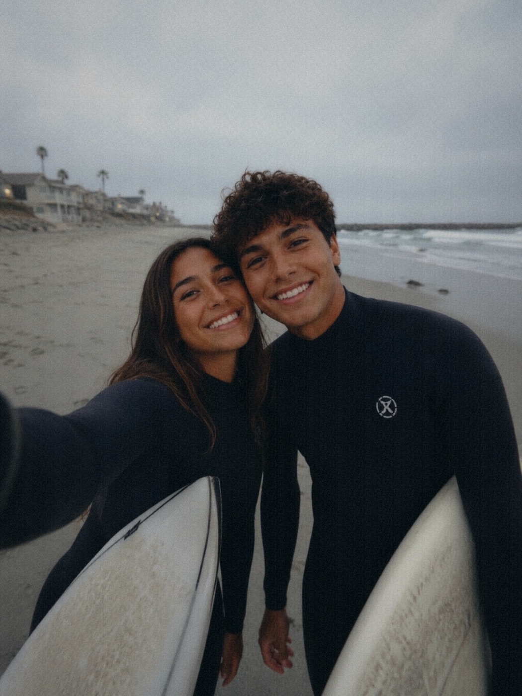
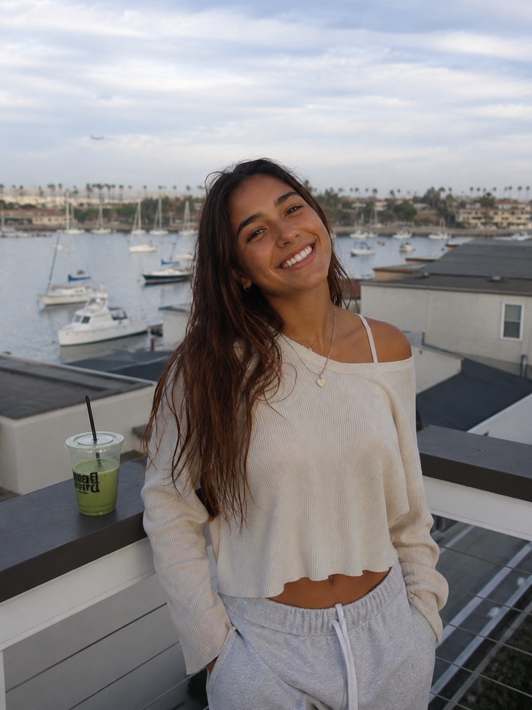

<p align="center">
  
</p>

<h1 align="center">Marenn 400</h1>

<p align="center">
  The film look from <a href="https://relayyyy.com">Relay</a>, open source.<br>
  Five Metal compute kernels, measured against real film. No LUTs, no dependencies.
</p>

<p align="center">
  <a href="https://developer.relayyyy.com">developer.relayyyy.com</a> · Swift + Metal · GPL-3.0
</p>

---

## What this is

Every photo shot in the Relay app develops through exactly one filter. There are no presets and no strength slider. This repo is that filter, the shipped source, byte for byte.

Marenn 400 was built by measuring real film scans, aligning them against digital captures of the same scenes, and fitting each stage of the pipeline until the color difference dropped to a few dE. One early finding shaped the whole thing: the look we were chasing has no geometric warp at all. It is color, optics, and grain, done carefully. Warm, never teal.

Drag the sliders at [developer.relayyyy.com](https://developer.relayyyy.com) to see it on real photos.

| Original | Marenn 400 |
| --- | --- |
|  |  |
|  |  |

## The pipeline

The whole filter lives in one file, `MarennFilter.swift`. The Metal source is embedded as a string and compiled at runtime, so the Swift structs and the shader stay in one place and cannot drift apart. Five kernels run in sequence:

1. **`marenn_grade`** does tone and color. A seven knot Hermite spline tone curve, cool shadow tint, warm midtone and highlight tints, global saturation, and a dedicated blue sky treatment that saturates, darkens, and hue shifts skies the way negative film renders them.
2. **`marenn_clarity`** softens highlights. Bright regions get a gentle ring blur plus a touch of bloom, so highlights roll off instead of clipping.
3. **`marenn_bright`** extracts the halation source. Everything above a luminance threshold, tinted toward the warm orange glow halation has on real stock.
4. **`marenn_blur`** spreads that glow. Two separable Gaussian passes at half resolution, sized relative to the photo so the effect scales from thumbnails to full captures.
5. **`marenn_composite`** models the lens and the stock. Screens the halation back in, then applies anisotropic edge defocus, chromatic aberration that grows toward the corners, a soft vignette, and two octave value noise grain weighted into the shadows.

Exposure is scene adaptive. Before the GPU work starts, the filter builds a luminance histogram of the actual photo and derives a gain from the median, clamped to a sane range. A dim indoor shot and a noon beach shot both land on the same roll.

One honest warning: the parameter defaults in `GradeP`, `ClarityP`, `BrightP`, and `CompP` look like magic numbers because they are. They are the measured, shipped values. Tuning them is the fun part, but the defaults are the Relay look.

## Try it from the command line

`Tools/marenn_cli.swift` is a small macOS harness that reads the Metal source straight out of `MarennFilter.swift` and runs the real pipeline on any image. No Xcode project needed:

```
swiftc -O Tools/marenn_cli.swift -o marenn
./marenn MarennFilter.swift beach.jpg out.png
```

Options:

```
--seed N      fix the grain seed for repeatable output
--nograin     disable grain entirely
```

It prints the computed exposure gain and scene median for each photo, which is handy when you start tuning.

## Use it in an app

`MarennFilter.swift` as shipped targets iOS (UIKit in, UIKit out):

```swift
let developed = MarennFilter.apply(to: photo)
```

The engine underneath (`MarennEngine`) works on `CGImage` and has no UIKit in its core path, so porting to macOS or an offline renderer mostly means swapping the entry point. The CLI harness is proof of that.

## Repo layout

```
MarennFilter.swift      the filter, Swift host code + embedded Metal source
Tools/marenn_cli.swift  macOS command line harness
Examples/               before and after samples used in this README
LICENSE                 GPL-3.0
```

## License

GPL-3.0. Use it, learn from it, build on it, and keep what you make open too. See `LICENSE` for the full text.

The Relay name, the Relay logo, and the app itself are not covered by this license. They belong to Tobias Schmidt Services LLC.
